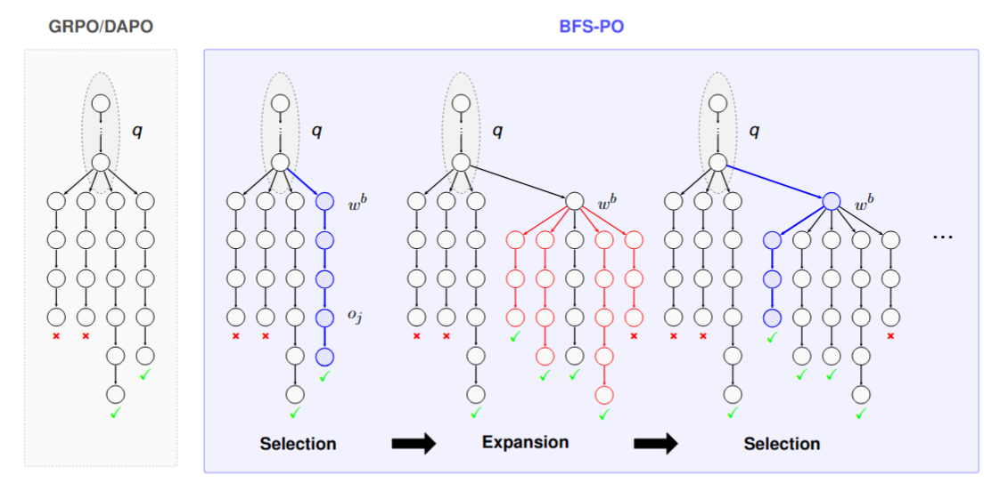

# BFS-PO: Best-First Search for Large Reasoning Models

**Fiorenzo Parascandolo<sup>1,2</sup>, Wenhui Tan<sup>3</sup>, Enver Sangineto<sup>1</sup>, Xiaoyi Yu<sup>3</sup>, Ruihua Song<sup>3</sup>, Rita Cucchiara<sup>1</sup>**

<sup>1</sup> University of Modena and Reggio Emilia, Modena, Italy<br>
<sup>2</sup> University of Pisa, Pisa, Italy<br>
<sup>3</sup> Gaoling School of Artificial Intelligence, Renmin University of China, Beijing, China

## Abstract

Large Reasoning Models (LRMs) have shown excellent performance in reasoning tasks using long Chain of Thought. However, this has also led to a significant increase of computational costs and the generation of verbose output, a phenomenon known as overthinking. The tendency to overthink is often exacerbated by Reinforcement Learning (RL) algorithms such as GRPO/DAPO. In this paper, we propose BFS-PO, an RL algorithm which alleviates this problem using a Best-First Search exploration strategy. Specifically, the reasoning chains generated at training time by BFS-PO are organized into a search tree, within which the shortest correct sequence is selected as the best and expanded using a backtracking mechanism based on maximum entropy nodes. In this way, we bias the exploration of the solution space towards the search for increasingly shorter solutions, training the LRM to generate progressively more concise answers. Using different benchmarks and base LRMs, we show that BFS-PO can simultaneously increase the LRM accuracy and shorten its reasoning chains.

## Getting started

### Install dependencies


```bash
conda create -n bfs-po python=3.10.19 pip -y
conda activate bfs-po
python -m pip install --upgrade pip
python -m pip install -r requirements.txt
```

### Add entropy computation to vLLM

We added entropy computation to vLLM to compute the entropy of the next-token distribution directly during rollout generation. Specifically, [`sampler.py`](vllm_entropy/vllm_overlay/vllm/v1/sample/sampler.py) computes  and stores one scalar per sequence and decoding step in `LogprobsTensors`. These values are then propagated by [`engine/logprobs.py`](vllm_entropy/vllm_overlay/vllm/v1/engine/logprobs.py) to the `entropy` field of the sampled token's `Logprob` object.

This implementation is based on `vllm==0.12.0`. After installing this version, run:

```bash
python vllm_entropy/add_entropy_to_vllm.py
```

### Download the datasets

The datasets are available on Hugging Face: [MetaMathQA-60k](https://huggingface.co/datasets/FiorenzoParascandolo/MetaMathQA-60k), [MATH-500](https://huggingface.co/datasets/math-ai/math500), [GSM8K](https://huggingface.co/datasets/openai/gsm8k), [MMLU-STEM](https://huggingface.co/datasets/TIGER-Lab/MMLU-STEM), and [AMC2023](https://huggingface.co/datasets/math-ai/amc23).

```bash
python - <<'DATASETS'
from datasets import load_dataset

load_dataset("FiorenzoParascandolo/MetaMathQA-60k", split="train")
load_dataset("math-ai/math500", split="test")
load_dataset("gsm8k", "main", split="test")
load_dataset("TIGER-Lab/MMLU-STEM", split="test")
load_dataset("math-ai/amc23", split="test")
DATASETS
```

### Evaluation

Download the [adapter](https://huggingface.co/FiorenzoParascandolo/Qwen3-1.7B-BFS-PO):

```bash
hf download FiorenzoParascandolo/Qwen3-1.7B-BFS-PO \
    --local-dir outputs/Qwen3-1.7B-BFS-PO
```

The script ```trl/jobs/eval_bfs_po_lora_16_seeds.sh``` loads the adapter on top of [Qwen/Qwen3-1.7B](https://huggingface.co/Qwen/Qwen3-1.7B). The base model is downloaded automatically on first use if it is not already cached. Set `BASE_MODEL_PATH` to an existing local copy of the same base model to reuse it.


### Training

The script ```bash trl/jobs/train_bfs_po_metamath.sh``` launches the training of [Qwen/Qwen3-1.7B](https://huggingface.co/Qwen/Qwen3-1.7B) with BFS-PO on [MetaMathQA-60k](https://huggingface.co/datasets/FiorenzoParascandolo/MetaMathQA-60k), evaluating on [MATH-500](https://huggingface.co/datasets/math-ai/math500) during training.

## Citation

```bibtex
@inproceedings{parascandolo2026bfs,
  title={BFS-PO: Best-First Search for Large Reasoning Models},
  author={Parascandolo, Fiorenzo and Tan, Wenhui and Sangineto, Enver and Yu, Xiaoyi and Song, Ruihua and Cucchiara, Rita},
  booktitle={NeurIPS},
  year={2026}
}
```

## Acknowledgements

We thank [Hugging Face TRL](https://github.com/huggingface/trl), [vLLM](https://github.com/vllm-project/vllm), and [PEFT](https://github.com/huggingface/peft) for their open-source libraries.
